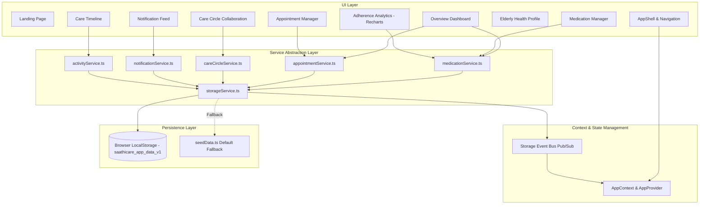

# SaathiCare — Architecture & Technical Design

## 1. Executive Overview

SaathiCare is an offline-capable, client-persisted collaborative elderly healthcare management platform built on React, TypeScript, Tailwind CSS, and LocalStorage.

The system is designed with a strict **Decoupled Repository Pattern** so that all data interactions go through service abstractions (`storageService`, `medicationService`, `appointmentService`, `careCircleService`, `notificationService`, `activityService`). This architecture allows replacing LocalStorage with an external database (such as Supabase or Firebase) without rewriting any frontend UI components.

---

## 2. System Architecture Diagram

---

## 3. Data Flow & State Management

1. **Reactive Pub/Sub Storage:**
   - Any write operation (`create`, `update`, `delete`, `confirmDose`, `reset`) calls `storageService.update(fn)`.
   - `storageService` writes to LocalStorage and notifies registered listeners on `EventBus`.
   - `AppContext` triggers an immediate React state update across all open components.

2. **Smart Missed-Dose Workflow:**
   - When triggered via the top bar or time monitor, `notificationService.simulateMissedDose()` creates a 3-tiered notification sequence:
     1. Urgent reminder for Elderly user (`Meera`).
     2. Priority alert for Caretaker (`Priya`) to initiate in-person check.
     3. Escalation notice for Family guardian (`Aarav`).
   - Simultaneously, an entry is appended to `ActivityLog` via `activityService.log()`.

3. **Data Schema Migration Strategy:**
   - The root object is version-tagged: `{ version: 1, ... }`.
   - Any schema modification increments `version`, and `storageService.get()` performs schema validation before restoring fallback seed data.

---

## 4. Multi-Role Simulated Access

Three roles share one synchronized state:
- **Elderly (`Meera Patel`):** Accessible large touch targets, simplified daily routine, 1-click dose confirmation.
- **Family (`Aarav Patel`):** Full prescription and appointment CRUD, adherence analytics, escalation monitoring.
- **Caretaker (`Priya Shah`):** Administration confirmation, vital signs recording, pending care tasks.

---

## 5. Security & Isolation

- All data operations are client-side only.
- Strict input sanitization via React JSX.
- Zero external network requests to third-party APIs or analytics.
